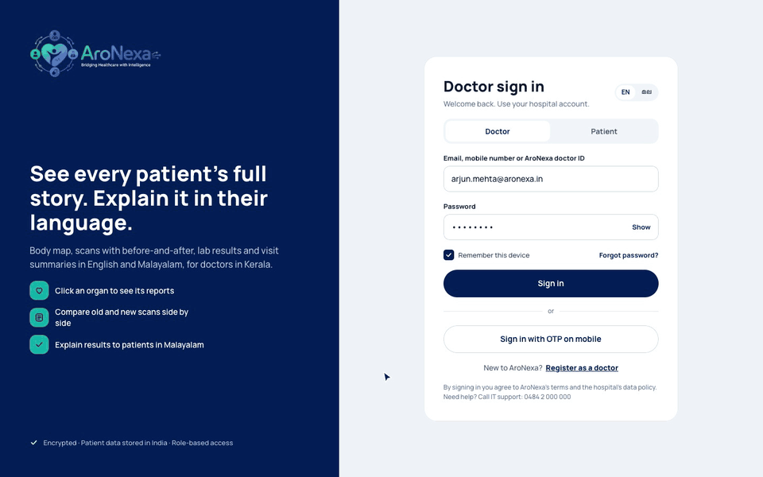
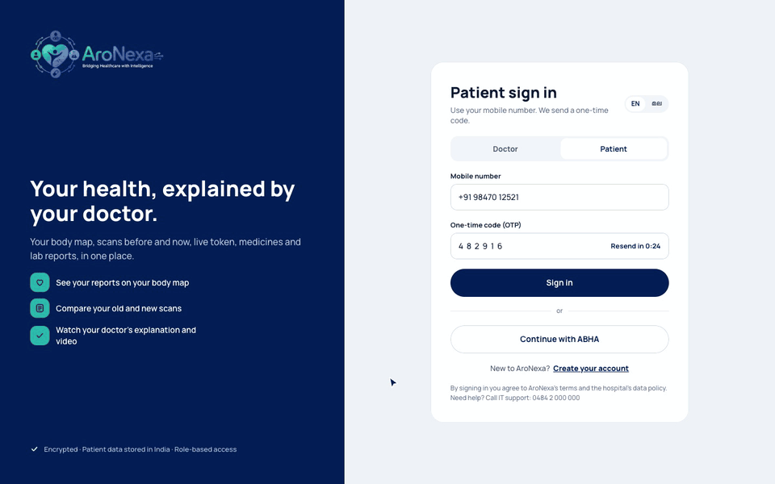
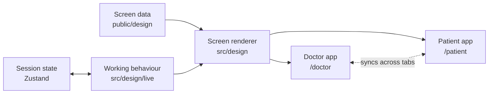

<div align="center">



<br /><br />

<a href="https://aronexa-prototype.vercel.app"></a>

<br /><br />


</div>

<br />

AroNexa is a clickable healthcare prototype with two connected sides: a workspace for doctors and an app for their patients. Records are organised around an interactive body map, so a doctor can click an organ, see its reports, and explain the results in English or Malayalam.


> [!NOTE]
> This is a frontend-only prototype for computer screens. There is no backend, every patient and doctor is made up, and it is not for real medical use.

<div align="center"></div>

## See it in motion

These are recordings of the real prototype.

### The doctor's day

Sign in, open a patient's record, and click through the body map.



### The patient's side

Sign in, then check your body map, your place in the queue, and your appointments.



<div align="center"></div>

## Features

<table>
<tr>
<th width="50%">🩺 For doctors</th>
<th width="50%">💙 For patients</th>
</tr>
<tr valign="top">
<td>

- **Home page:** today's patients, alerts and billing at a glance
- **Calendar:** any month or day, blocked time and leave
- **Patient record:** overview, timeline, medicines and allergies
- **Body map:** click an organ to see its reports and tests
- **Scans and reports:** compare results side by side
- **Explain to patient:** clear summaries in English and Malayalam
- **Clinical notes, labs and documents:** with PDF downloads
- **Billing:** collect payments, print receipts, export CSV

</td>
<td>

- **Find care:** search for doctors and clinics, then book a visit
- **Live queue:** follow your place on the day of a visit
- **Appointments:** book, move or cancel
- **My body:** the same body map, in plain language
- **Reports and scans:** with explanations from your doctor
- **Medicines and lab tests:** all in one place
- **Bills, records and sharing:** pay, download and share
- **Family and emergency:** profiles for relatives, help in one click

</td>
</tr>
</table>

<details>
<summary><b>View more screenshots</b></summary>
<br />

<table>
<tr>
<td width="50%"></td>
<td width="50%"></td>
</tr>
<tr>
<td align="center"><b>Doctor home</b></td>
<td align="center"><b>Patient home</b></td>
</tr>
<tr>
<td width="50%"></td>
<td width="50%"></td>
</tr>
<tr>
<td align="center"><b>Doctor body map</b></td>
<td align="center"><b>Patient body map</b></td>
</tr>
<tr>
<td colspan="2"></td>
</tr>
<tr>
<td colspan="2" align="center"><b>Sign in</b></td>
</tr>
</table>

</details>

<div align="center"></div>

## Run it locally

You'll need [Node.js](https://nodejs.org) 20.9 or later.

```bash
git clone https://github.com/rahulmjayusetuai/ARONEXA-PROTOTYPE.git
cd ARONEXA-PROTOTYPE
npm install
npm run dev
```

Open [http://localhost:3000](http://localhost:3000) and click **Sign in**, as the details are already filled in. To see the other side, choose the **Patient** tab first. Each side offers a short, skippable tour on your first visit.

| Command | What it does |
| --- | --- |
| `npm run dev` | Starts the development server |
| `npm run build` | Builds the production site |
| `npm start` | Serves the production build |
| `npm run lint` | Checks the code with ESLint |

## How it works

Each screen is stored as data and drawn as HTML in the browser. A separate layer adds the working behaviour on top.



| Path | What it holds |
| --- | --- |
| `src/app/` | Pages and routes for `/doctor` and `/patient` |
| `src/design/DesignApp.tsx` | The app shell: current screen, pop-ups and transitions |
| `src/design/Node.tsx` | Draws one layer of a screen as HTML |
| `src/design/store.ts` | Navigation, pop-ups, typed values and control states |
| `src/design/live/` | Forms, filters, the calendar, downloads, billing and the tour |
| `public/design/` | Screen data, images and vector graphics |
| `public/video/` | ECG explainer videos in English and Malayalam |

## Good to know

- **Sample date:** "today" is always Thursday, 15 May 2025, to match the sample data.
- **Saved changes:** anything you change lasts until the browser tab closes.
- **Simulated actions:** messages, calls, lab orders and council checks don't reach anyone.
- **Screen size:** it's designed for computers, and phone layouts aren't included.
