<div align="center">


<br /><br />

<a href="https://aronexa-prototype.vercel.app"></a>

<br /><br />


</div>

<br />

AroNexa is a clickable healthcare prototype. At its heart are two connected sides: a workspace for doctors and an app for their patients. Records are organised around an interactive body map, so a doctor can click an organ, see its reports, and explain the results in English or Malayalam. Around them sit portals for pharmacies, clinics, labs, delivery riders, the AroNexa team and partners.


> [!NOTE]
> This is a frontend-only prototype for computer screens. There is no backend, every patient and doctor is made up, and it is not for real medical use.

<div align="center"></div>

## See it in motion

These are recordings of the real prototype.

### The doctor's day

Sign in, open a patient's record, and click through the body map.

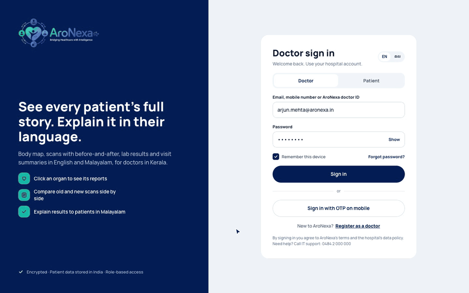

### The patient's side

Sign in, then check your body map, your place in the queue, and your appointments.

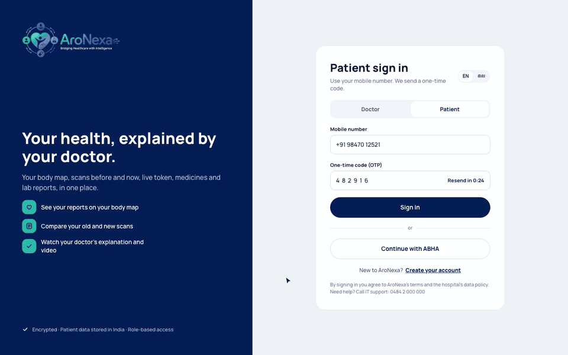

### The pharmacy

Open a request, send a quote, approve a substitute, bill a walk-in customer and ask dealers for stock.

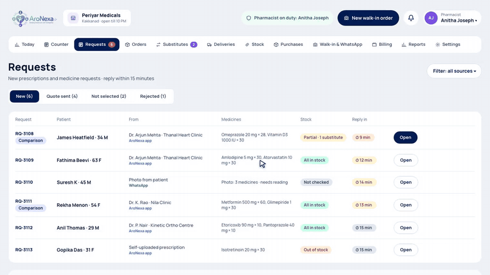

### The clinic

Check patients in, collect fees, offer a late patient's slot to someone else, and invite staff.

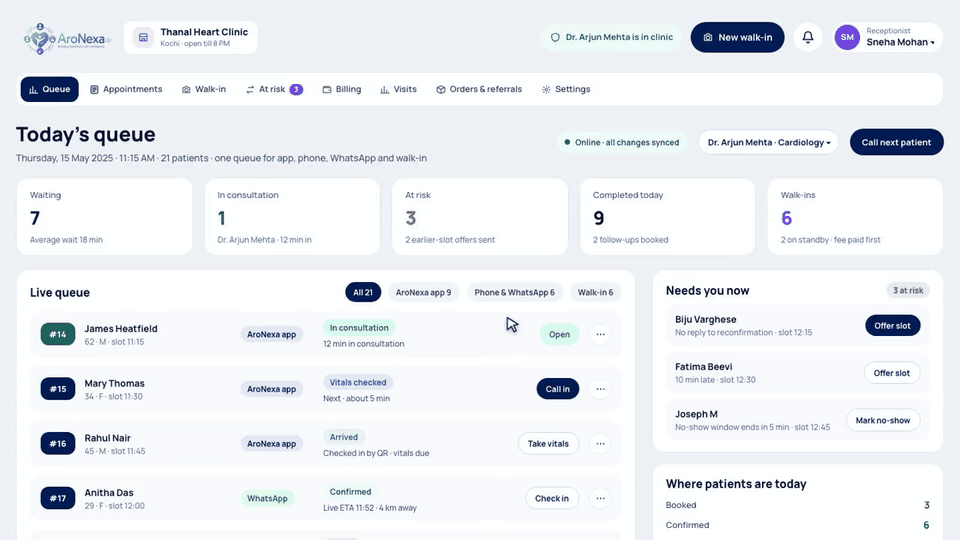

### The lab

Assign a home collector, handle requests, upload report files, then review and publish as the pathologist.

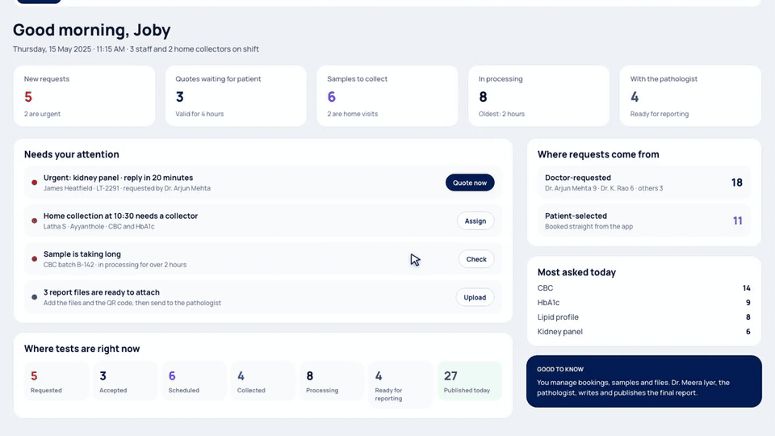

<div align="center"></div>

## Features

<table>
<tr>
<th width="50%">🩺 For doctors</th>
<th width="50%">💙 For patients</th>
</tr>
<tr valign="top">
<td>

- **Home page:** today's patients, alerts and billing at a glance
- **Calendar:** any month or day, blocked time and leave
- **Patient record:** overview, timeline, medicines and allergies
- **Body map:** click an organ to see its reports and tests
- **Scans and reports:** compare results side by side
- **Explain to patient:** clear summaries and a narrated video preview, in English and Malayalam
- **Clinical notes, labs and documents:** with PDF downloads
- **Billing:** collect payments, print receipts, export CSV

</td>
<td>

- **Find care:** search for doctors and clinics, then book a visit
- **Live queue:** follow your place on the day of a visit
- **Appointments:** book, move or cancel
- **My body:** the same body map, in plain language
- **Reports and scans:** with explanations and narrated videos from your doctor
- **Health hub:** short narrated videos from doctors, in English and Malayalam
- **Medicines and lab tests:** all in one place
- **Bills, records and sharing:** pay, download and share
- **Family and emergency:** profiles for relatives, help in one click

</td>
</tr>
</table>

### Videos and voices

Every video has English and Malayalam narration, with captions. The switch under each video changes the language.

| Where | What plays |
| --- | --- |
| Guide videos | A one-minute narrated tour of the doctor, patient, pharmacy, clinic and lab sides, shown the first time you sign in. **Guide video** at the bottom left plays it again |
| Patient › Health hub | 12 short videos from doctors on blood pressure, breathing, medicines, potassium and knee recovery. The chosen language carries over to the next video |
| Doctor › Explain to patient | **▶ Watch preview** plays a narrated explainer for each of 10 reports, with the storyboard timed to the voice |
| Patient › Reports | The same explainers, as the patient sees them |
| Patient › Home | **Listen** on an explained report plays the doctor's summary aloud |

<details>
<summary><b>View more screenshots</b></summary>
<br />

<table>
<tr>
<td width="50%">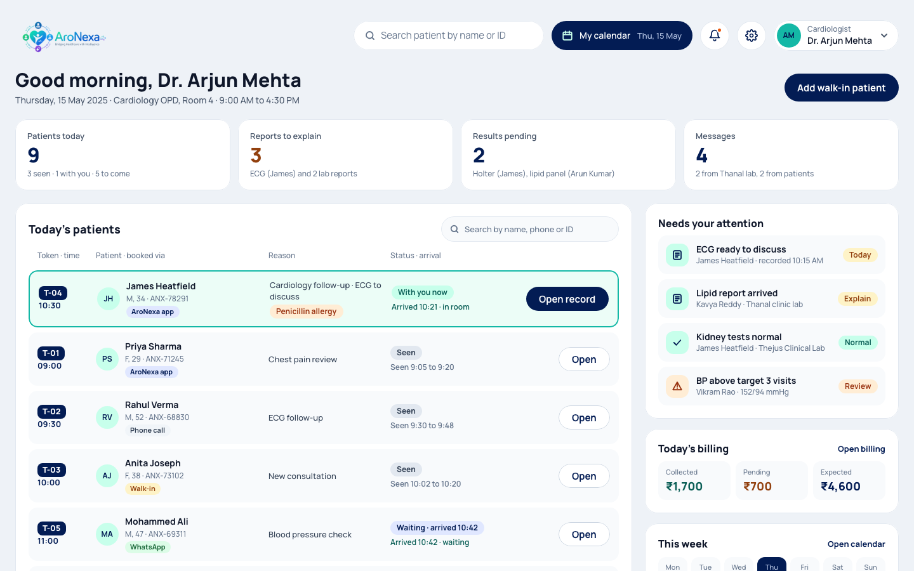</td>
<td width="50%">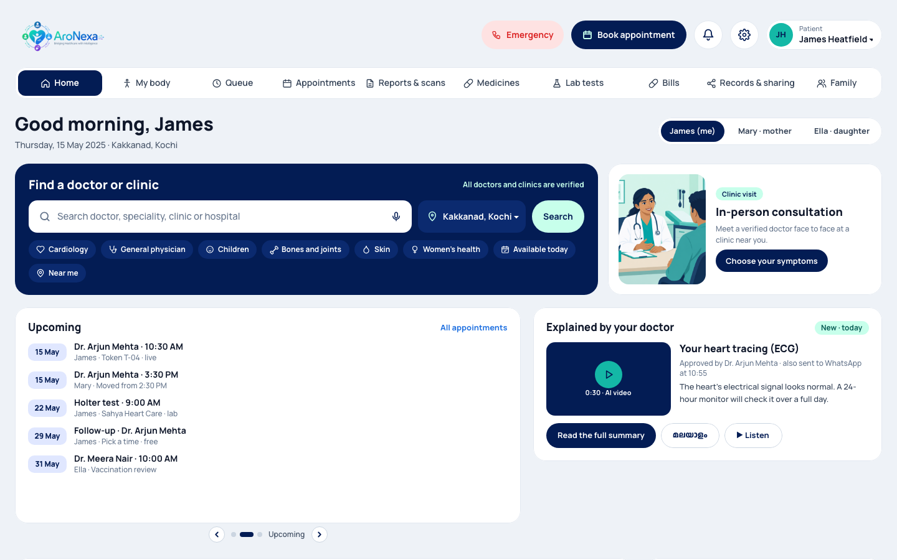</td>
</tr>
<tr>
<td align="center"><b>Doctor home</b></td>
<td align="center"><b>Patient home</b></td>
</tr>
<tr>
<td width="50%">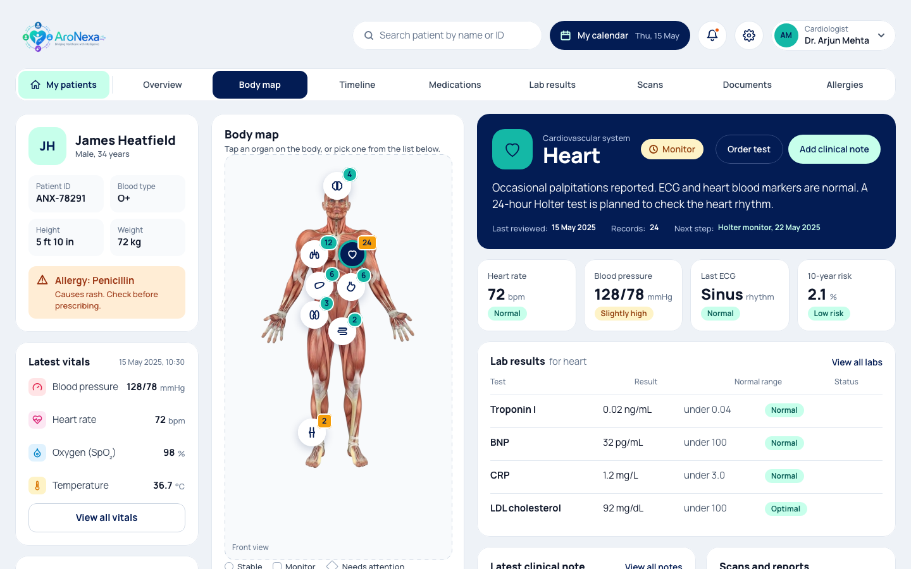</td>
<td width="50%">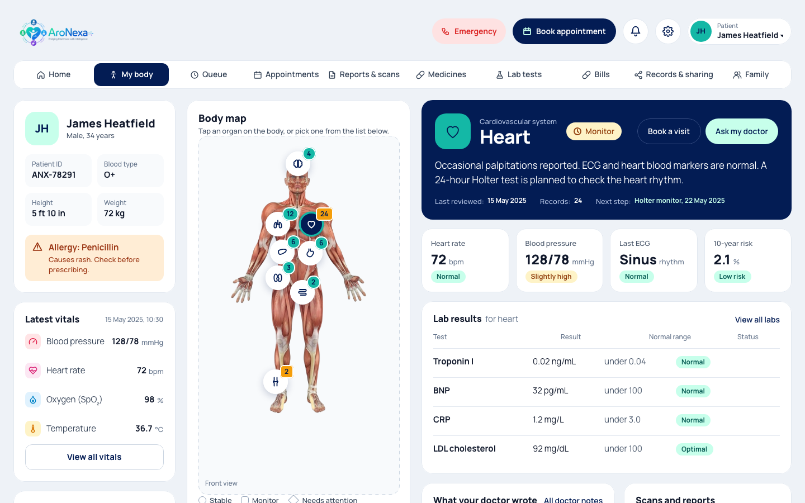</td>
</tr>
<tr>
<td align="center"><b>Doctor body map</b></td>
<td align="center"><b>Patient body map</b></td>
</tr>
<tr>
<td colspan="2">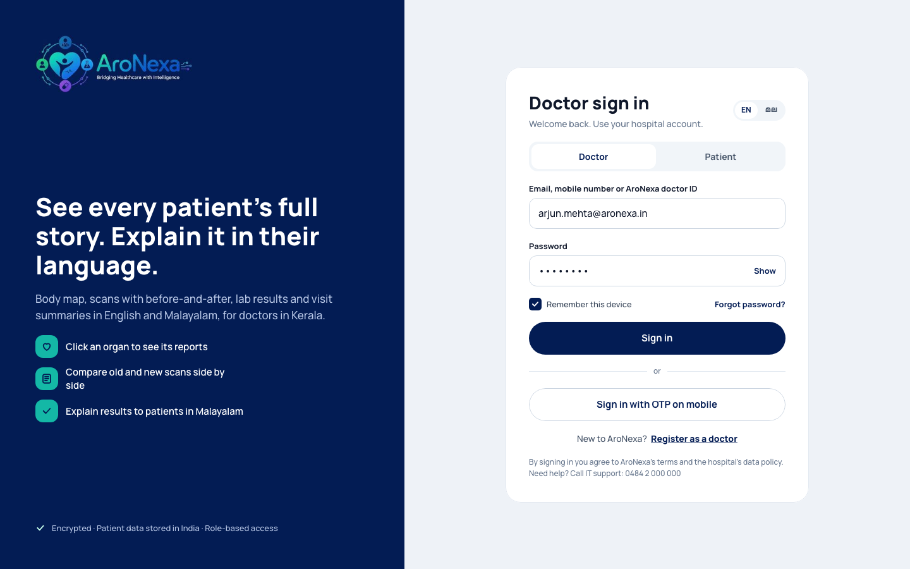</td>
</tr>
<tr>
<td colspan="2" align="center"><b>Sign in</b></td>
</tr>
</table>

</details>

<div align="center"></div>

## Run it locally

You'll need [Node.js](https://nodejs.org) 20.9 or later.

```bash
git clone https://github.com/rahulmjayusetuai/ARONEXA-PROTOTYPE.git
cd ARONEXA-PROTOTYPE
npm install
npm run dev
```

Open [http://localhost:3000](http://localhost:3000) and click **Sign in**, as the details are already filled in. To see the other side, choose the **Patient** tab first. The other portals open at their own address, listed under [Other areas](#other-areas).

The first time you sign in on a side, a short narrated guide video plays. You can skip it, and the **Guide video** button at the bottom left plays it again at any time.

| Command | What it does |
| --- | --- |
| `npm run dev` | Starts the development server |
| `npm run build` | Builds the production site |
| `npm start` | Serves the production build |
| `npm run lint` | Checks the code with ESLint |

## How it works

Each screen is stored as data and drawn as HTML in the browser. A separate layer adds the working behaviour on top.

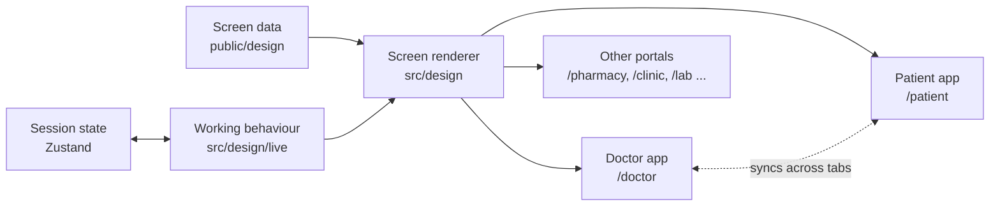

| Path | What it holds |
| --- | --- |
| `src/app/` | Pages and routes for `/doctor`, `/patient` and each portal |
| `src/design/DesignApp.tsx` | The app shell: current screen, pop-ups and transitions |
| `src/design/Node.tsx` | Draws one layer of a screen as HTML |
| `src/design/store.ts` | Navigation, pop-ups, typed values and control states |
| `src/design/live/` | Forms, filters, the calendar, downloads, billing and the video players |
| `public/design/` | Screen data, images and vector graphics |
| `public/video/` | Guide, Health hub and report explainer videos and narration, in English and Malayalam, with captions |

## Other areas

Besides `/doctor` and `/patient`, these parts of the product open at their own address. Each starts at its sign-in page.

| Address | Who it's for | Guide video |
| --- | --- | --- |
| `/pharmacy` | Pharmacy staff: requests, quotes, substitutes, orders, deliveries, counter billing, stock, dealers and reports | English and Malayalam |
| `/clinic` | Reception (live queue, walk-ins, appointments) and the clinic admin | English and Malayalam |
| `/lab` | Lab staff and the pathologist | English and Malayalam |
| `/rider` | Delivery riders (a phone-sized app) | Not yet |
| `/team` | The AroNexa platform and support teams | Not yet |
| `/partner` | Insurers, medicine dealers and sellers | Not yet |

The doctor's and patient's guide videos are also in English and Malayalam. Each video has captions, and the language switch sits under the video.

New frames from Figma are added with the tools in `scripts/figma-export`.

## Good to know

- **Sample date:** "today" is always Thursday, 15 May 2025, to match the sample data.
- **Saved changes:** anything you change lasts until the browser tab closes.
- **Health videos:** written as samples for the prototype. They are not medical advice.
- **Simulated actions:** messages, calls, lab orders and council checks don't reach anyone.
- **Pages still being designed:** a few clinic and lab buttons lead to pages that aren't designed yet. They show a short "isn't ready yet" note and keep you where you are.
- **Screen size:** it's designed for computers, and phone layouts aren't included. The rider app is the exception, shown at phone size.
